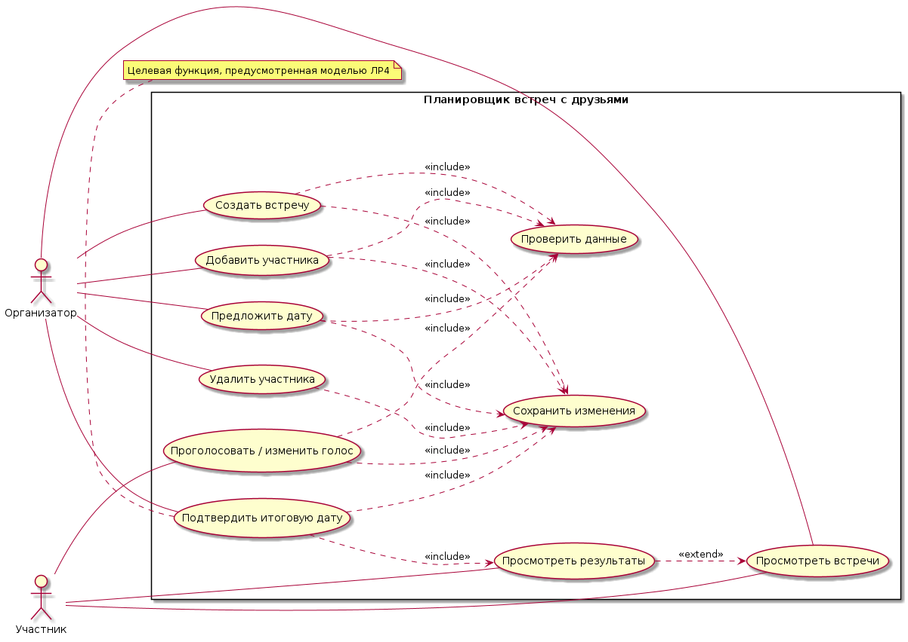
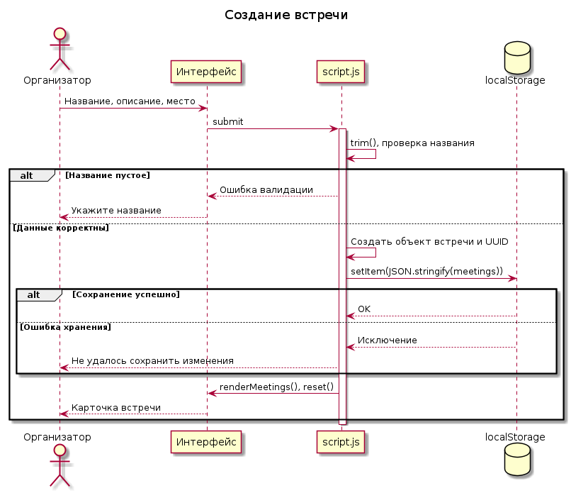
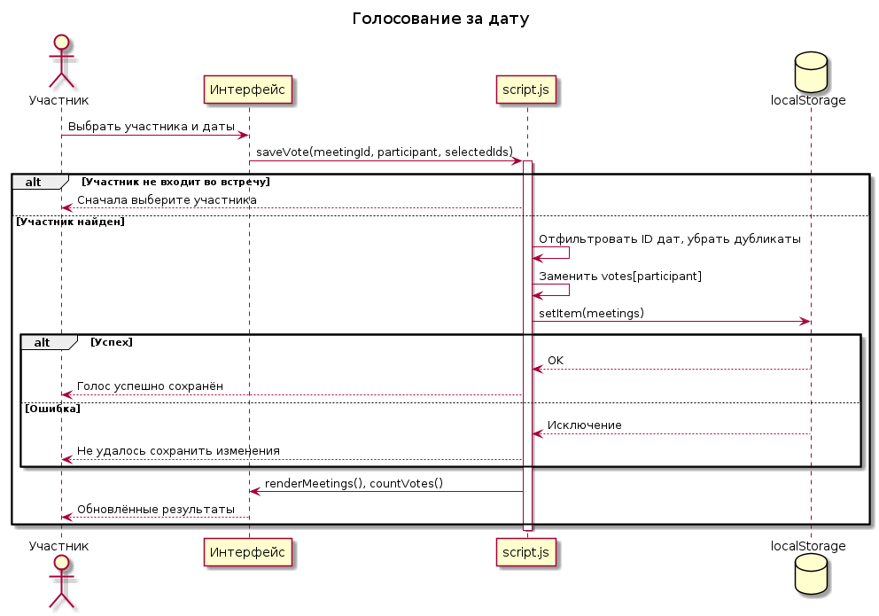
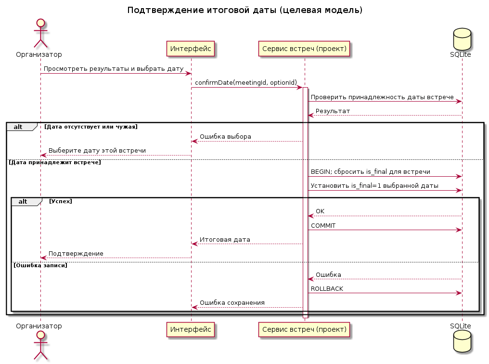
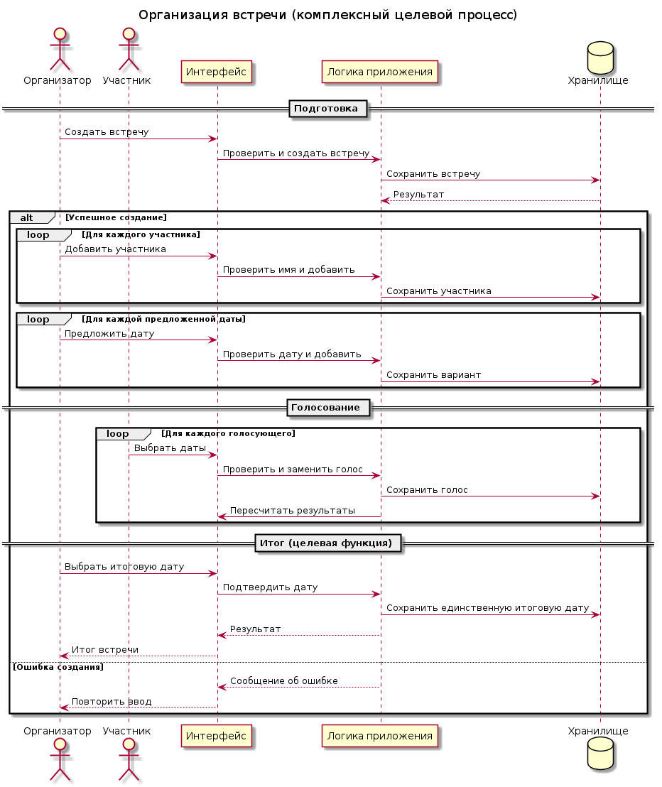

# Лабораторная работа №5. Диаграммы поведения системы

Проект «Планировщик встреч с друзьями».

## Use Case

[Исходник PlantUML](../use_case/use_case_diagram.puml)

Акторы: организатор создаёт встречу, управляет участниками и предлагает даты; участник просматривает встречи, голосует и смотрит результаты. Это логические роли, а не реализованная авторизация. Проверка данных и сохранение — обязательные включаемые сценарии; просмотр результатов расширяет просмотр встреч.

## Диаграммы последовательности

| Сценарий | Описание | Исходник |
|---|---|---|
| Создание встречи | Ввод, проверка названия, сохранение, обновление интерфейса | [PUML](sequence/create_meeting_sequence.puml) |
| Голосование | Проверка участника, замена голоса, подсчёт результатов | [PUML](sequence/vote_sequence.puml) |
| Итоговая дата | Целевая транзакция SQLite, проверка принадлежности даты и единственности итогового варианта | [PUML](sequence/final_date_sequence.puml) |
| Организация встречи | Комплексный процесс: подготовка, циклы добавления участников и дат, голосование, итог | [PUML](sequence/meeting_workflow_sequence.puml) |

## Границы модели

Текущий прототип использует script.js и localStorage. Подтверждение итоговой даты и сервис SQLite — целевое поведение на основе модели ЛР4, а не реализованный сервер. Комплексная диаграмма описывает целевой успешный процесс и альтернативу ошибки создания. 

## Инструменты

PlantUML. Генерация PNG и SVG: `plantuml -charset UTF-8 -tpng docs/use_case/*.puml docs/behavior/sequence/*.puml` и аналогично с `-tsvg`.
